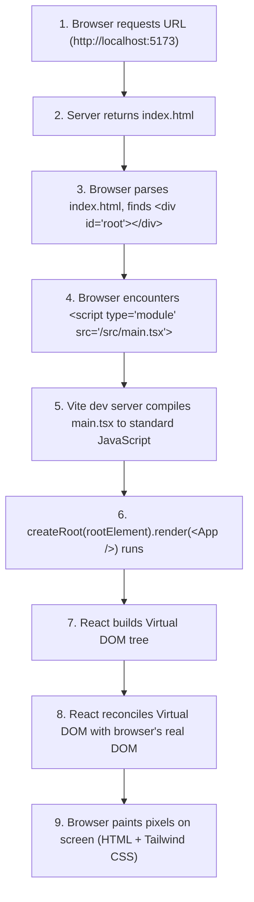

# DevSphere — Week 1 Learning Notes & Mentorship Guide
> **Student Resource:** Milestone 01 — Frontend Foundation & Landing Page  
> **Target Audience:** BTech Computer Science Student building a real-world SaaS startup.

---

## Table of Contents
1. [Engineering Mindset: Building Real Software](#1-engineering-mindset-building-real-software)
2. [The Core Technology Stack](#2-the-core-technology-stack)
3. [Deep-Dive: Foundational Web & React Concepts](#3-deep-dive-foundational-web--react-concepts)
4. [The Execution Journey: How the Browser Renders DevSphere](#4-the-execution-journey-how-the-browser-renders-devsphere)
5. [Component-by-Component Walkthrough](#5-component-by-component-walkthrough)
6. [Real Bugs We Encountered & Fixed in Week 1](#6-real-bugs-we-encountered--fixed-in-week-1)
7. [Student Self-Test: Questions You Should Be Able to Answer](#7-student-self-test-questions-you-should-be-able-to-answer)

---

## 1. Engineering Mindset: Building Real Software

In college assignments, students often build disposable applications: single-file scripts, hardcoded HTML, or copy-pasted templates. In software engineering, code is read 10 times more than it is written, and projects grow over months and years.

When building **DevSphere**, we treat Week 1 as the bedrock of a 30-week startup journey. Every choice we made follows three principles:
- **Separation of Concerns:** Data lives in `src/data/`, types in `src/types/`, presentational elements in `src/components/`, and pages in `src/pages/`.
- **Type Safety First:** If data shapes change, TypeScript will immediately highlight broken code at compile time rather than letting users discover crashes in production.
- **Accessibility by Default:** Accessible software isn't an afterthought; it is built into the HTML structure, keyboard navigation, and screen reader announcements from day one.

---

## 2. The Core Technology Stack

### A. React (v19)
- **What is it?** A declarative, component-based JavaScript library created by Meta for building user interfaces.
- **Why do we use it?** Instead of manually manipulating the browser's DOM (`document.getElementById().innerHTML = ...`), React lets us describe *what* the UI should look like for a given state. When state changes, React efficiently updates only the affected DOM nodes.

### B. TypeScript (v5.8+)
- **What is it?** A strongly typed superset of JavaScript developed by Microsoft.
- **Why do we use it?** JavaScript is dynamically typed, meaning a variable can hold a string, then a number, leading to runtime `TypeError: undefined is not a function` errors. TypeScript adds static type checking that runs during development and compilation, catching errors before your code ever runs in a browser.

### C. Vite (v8)
- **What is it?** A modern frontend build tool created by Evan You (creator of Vue.js).
- **Why do we use it?** Traditional tools like Webpack bundle your entire application into huge files before you can preview changes. Vite uses browser-native ES Modules (ESM) during development, giving us instant server boot times and millisecond Hot Module Replacement (HMR).

### D. Tailwind CSS (v3.4)
- **What is it?** A utility-first CSS framework packed with classes like `flex`, `pt-4`, `text-center`, and `bg-indigo-600`.
- **Why do we use it?** It eliminates context switching between HTML/TSX files and separate CSS files. More importantly, its Just-In-Time (JIT) compiler scans your project files and only outputs the exact CSS classes you actually use, resulting in tiny production bundle sizes (our compiled CSS is only ~36KB uncompressed, ~6.5KB gzipped!).

### E. Lucide React
- **What is it?** A clean, modern open-source icon library.
- **Why do we use it?** It provides tree-shakeable SVG icons as native React components. "Tree-shakeable" means if we only use 8 icons, the other 1,000+ icons in the package are completely excluded from our final build.

---

## 3. Deep-Dive: Foundational Web & React Concepts

### What is JSX / TSX?
In traditional web development, HTML and JavaScript were kept in separate files. React introduced **JSX** (JavaScript XML), allowing us to write HTML-like markup directly inside JavaScript functions. When using TypeScript, the file extension is `.tsx`.

Under the hood, JSX is *not* HTML. The compiler transforms this:
```tsx
<div className="card">
  <h3>Alex Chen</h3>
</div>
```
Into standard JavaScript function calls:
```js
React.createElement('div', { className: 'card' },
  React.createElement('h3', null, 'Alex Chen')
);
```

### What is a Component?
A React component is simply a JavaScript function that takes inputs (called **props**) and returns UI elements (written in **JSX**).
```tsx
export const Badge: React.FC<{ label: string }> = ({ label }) => {
  return <span className="bg-indigo-500/10 text-indigo-400">{label}</span>;
};
```

### What are Props? (Unidirectional Data Flow)
**Props** (short for properties) allow parent components to pass data down to child components.
- In React, data flows in **one direction**: from Parent to Child.
- Children cannot modify their props directly (props are read-only / immutable).
- If a child needs to inform the parent about an event (like a button click), the parent passes a *callback function* as a prop.

```text
[Home Component] (Holds modal state)
       ↓ Passes `feature` data as props
[FeatureCard Component]
       ↑ Calls `onExplore(feature)` when clicked
```

### What is State (`useState`)?
While props represent data passed into a component from the outside, **state** is data managed *inside* the component that can change over time.
```tsx
const [isMenuOpen, setIsMenuOpen] = useState(false);
```
- `isMenuOpen`: The current value.
- `setIsMenuOpen`: The updater function.
- When `setIsMenuOpen(true)` is called, React schedules a re-render of the component and updates the DOM to reflect the new state.

---

## 4. The Execution Journey: How the Browser Renders DevSphere

Understanding how an app goes from a text file on disk to rendered pixels on your screen is an essential computer science fundamental:



1. **`index.html`:** The browser receives the skeleton HTML containing `<div id="root"></div>`.
2. **`main.tsx`:** The JavaScript entry point runs. It locates the root element using `document.getElementById('root')!`.
3. **`createRoot`:** React takes control of that DOM container.
4. **`App.tsx` & `Home.tsx`:** React executes your component functions, building an in-memory representation called the **Virtual DOM**.
5. **Reconciliation:** React calculates the minimal DOM mutations required and updates the actual browser DOM.

---

## 5. Component-by-Component Walkthrough

### 1. `src/components/Navbar.tsx`
- **Purpose:** Navigation header across all viewports.
- **Key Concepts:**
  - `useState(false)` manages `isMobileMenuOpen` and `isScrolled`.
  - `useEffect` attaches a scroll listener (`window.addEventListener('scroll', ...)`) and cleans it up when the component unmounts to prevent memory leaks.
  - ARIA attributes: `aria-expanded={isMobileMenuOpen}` communicates menu state to screen readers.

### 2. `src/components/Hero.tsx`
- **Purpose:** Above-the-fold value proposition and interactive proof mockup.
- **Key Concepts:**
  - Interactive tab switcher (`activeTab` state: `'profile' | 'code' | 'proof'`) showing prospective users how DevSphere works without misleading them with fake statistics.
  - CSS gradients using Tailwind (`bg-gradient-to-r from-indigo-400 via-cyan-300 to-indigo-300 bg-clip-text text-transparent`).

### 3. `src/components/FeatureCard.tsx`
- **Purpose:** Modular card displaying each of the 8 core platform pillars.
- **Key Concepts:**
  - Uses an **Icon Dictionary** pattern (`Record<Feature['iconName'], LucideIcon>`) to dynamically render the correct SVG icon based on a string name.
  - Pure presentational component that accepts strongly typed props (`feature: Feature`).

### 4. `src/components/Features.tsx`
- **Purpose:** Responsive container for the 8 platform features.
- **Key Concepts:**
  - Uses `.map()` to iterate through `PLATFORM_FEATURES`.
  - Assigns a unique `key={feature.id}` to every child element so React's reconciliation engine can track list items efficiently.

### 5. `src/components/HowItWorks.tsx`
- **Purpose:** 4-step progressive developer journey.
- **Key Concepts:**
  - Responsive grid transitioning from 1 column on mobile to 2 on tablet and 4 on desktop (`grid-cols-1 md:grid-cols-2 lg:grid-cols-4`).
  - Highlights the **Verifiable Artifact** produced at each step (e.g. Git commit attribution, test suite execution hash).

### 6. `src/components/Differentiation.tsx`
- **Purpose:** Articulates the "Proof over Claims" startup thesis.
- **Key Concepts:**
  - Side-by-side comparison matrix comparing conventional resumes (unverified text claims) with DevSphere's verification protocol.
  - Includes a transparent disclosure that verification engines are actively being developed across milestones.

### 7. `src/components/CallToAction.tsx`
- **Purpose:** Conversion section driving user interest and waitlist actions.
- **Key Concepts:**
  - Interactive terminal simulation (`npx devsphere@latest init`).
  - Direct connection to the modal workflow.

### 8. `src/components/Footer.tsx`
- **Purpose:** Bottom navigation, legal placeholders, and transparency notice.
- **Key Concepts:**
  - Categorized navigation links organized via `src/data/navigation.ts`.
  - Uses a pure module constant for the copyright year (`const CURRENT_YEAR = 2026`) ensuring pure rendering without React compiler warnings.

### 9. `src/components/Modal.tsx`
- **Purpose:** Accessible dialog providing feedback when buttons for future milestones are clicked.
- **Key Concepts:**
  - Focus trapping and automatic focus on mount via `useRef<HTMLButtonElement>()`.
  - Global `Escape` key listener.
  - Locks background scroll with `document.body.style.overflow = 'hidden'` while open, resetting on close.
  - Strict ARIA attributes: `role="dialog"`, `aria-modal="true"`.

---

## 6. Real Bugs We Encountered & Fixed in Week 1

Learning how to diagnose and fix compiler errors is what makes a senior engineer. Here are the real issues we resolved during development:

### Bug 1: TypeScript `verbatimModuleSyntax` Error (`TS1484`)
- **Error:** `'Feature' is a type and must be imported using a type-only import when 'verbatimModuleSyntax' is enabled.`
- **Why it happened:** In TypeScript, interfaces and types only exist during compile time and are stripped out of the final JavaScript file. When `verbatimModuleSyntax: true` is enabled in `tsconfig.json`, TypeScript strictly requires developers to write `import type { Feature } from '...'`. This helps bundlers know with 100% certainty that the import can be completely omitted from the compiled output.
- **The Fix:** We updated all type imports to use `import type { ... }`.

### Bug 2: React Render Purity Warning (`oxlint`)
- **Error:** `react(purity): Cannot call impure function during render ... Date is an impure function.`
- **Why it happened:** React's upcoming compiler and concurrent rendering model require component render functions to be **pure functions** (given the same inputs, they must always return the exact same JSX output). Calling `new Date().getFullYear()` inside a component function makes the render dependent on the system clock rather than props and state.
- **The Fix:** We extracted the constant outside the component function: `const CURRENT_YEAR = 2026;`.

### Bug 3: Windows PowerShell Command Chaining
- **Error:** `The token '&&' is not a valid statement separator in this version.`
- **Why it happened:** In Unix/Bash shells, `cmd1 && cmd2` is standard. In older or default Windows PowerShell configurations, `;` or sequential execution is required.
- **The Fix:** We executed dependency installations sequentially and cleanly.

---

## 7. Student Self-Test: Questions You Should Be Able to Answer

Test your understanding of Week 1 concepts with these questions:

### Q1: Why do we use `key={feature.id}` when rendering lists in React?
> **Answer:** React uses keys to identify which items in a list have changed, been added, or been removed. Without unique keys, React has to re-render the entire list from scratch whenever any element changes, causing performance degradation and potential UI bugs with inputs.

### Q2: What is the difference between props and state?
> **Answer:** Props are passed *into* a component from its parent and are read-only (immutable). State is internal data created and managed *inside* the component (via `useState`) that can change over time in response to user actions.

### Q3: Why is Tailwind CSS faster in production than writing custom CSS files?
> **Answer:** Because Tailwind's compiler analyzes which utility classes you actually wrote in your code and discards the rest. A project with thousands of custom CSS lines often ships hundreds of kilobytes of unused styles, whereas our Tailwind output was under 7KB gzipped.

### Q4: What does `createRoot(document.getElementById('root')!).render(<App />)` do?
> **Answer:** It connects the React virtual hierarchy to the real browser DOM. The exclamation mark (`!`) is TypeScript's non-null assertion operator, telling the compiler that the `#root` element is guaranteed to exist in `index.html`.

### Q5: Why did we build an accessible Modal instead of leaving buttons with empty `onClick={() => {}}` handlers?
> **Answer:** Professional applications never leave dead buttons. Providing transparent milestone feedback informs the user that the button is wired up and working as intended, and building it accessibly ensures keyboard users and screen readers are properly supported.
